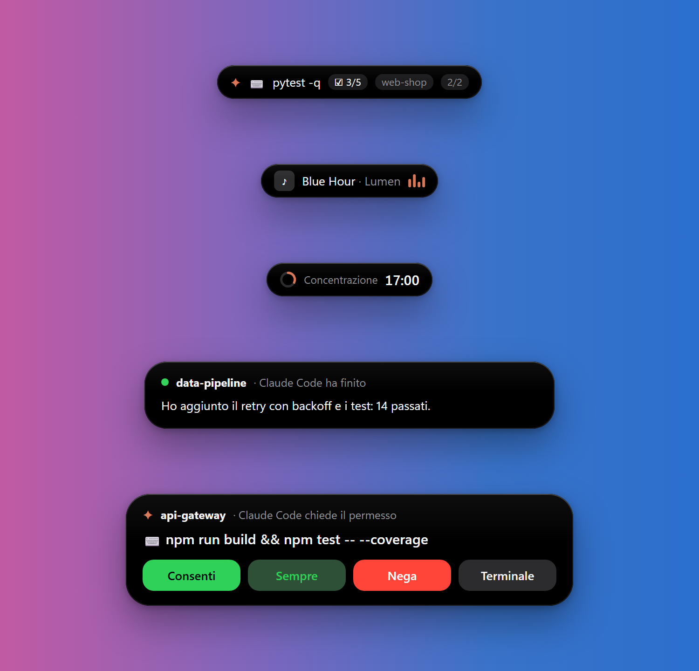
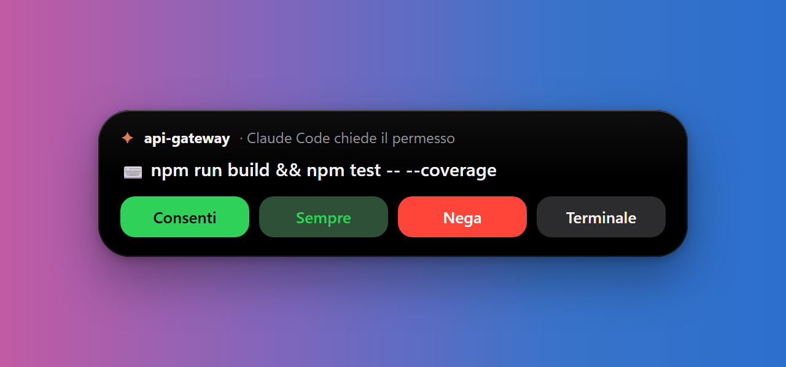
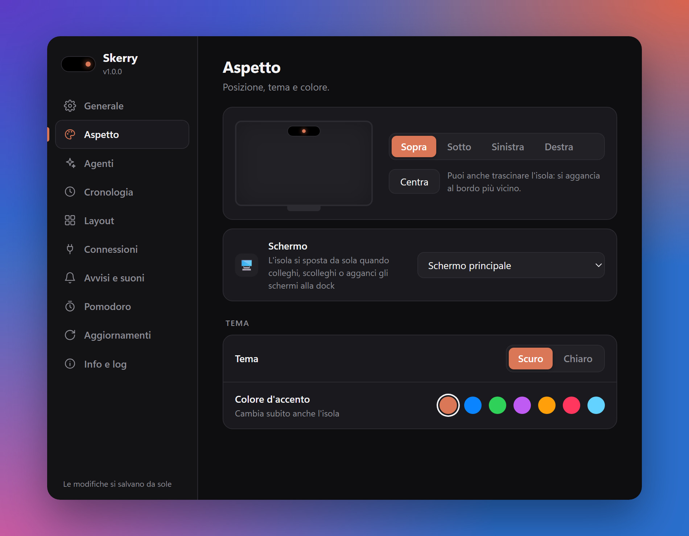
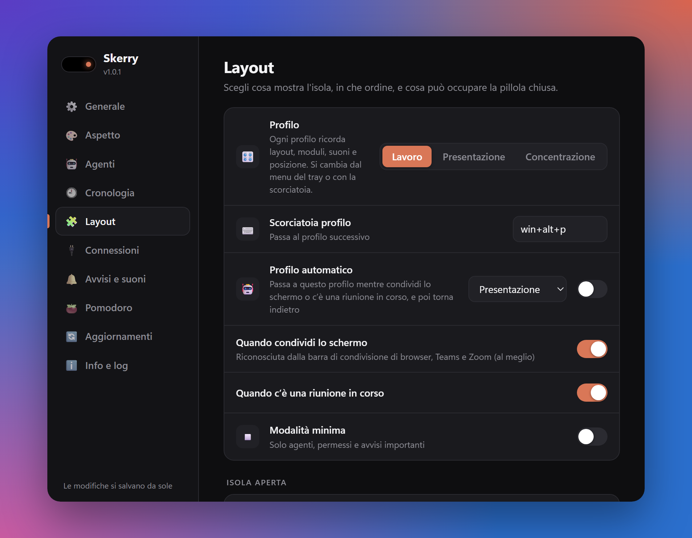
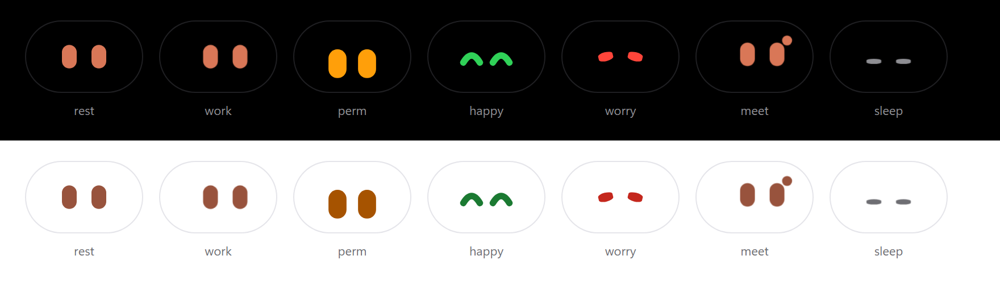

<p align="center">
  <picture>
    <source media="(prefers-color-scheme: dark)" srcset="assets/brand/skerry-logo-dark.svg">
    
  </picture>
</p>

<p align="center">
  <b>Una dynamic island per Windows che mostra cosa stanno facendo Claude Code e Codex e ti fa approvare le loro richieste di permesso senza lasciare il lavoro.</b>
</p>

<p align="center">
  <a href="https://github.com/fabrisimo/skerry/releases/latest"></a>
</p>

<p align="center">
  <a href="https://github.com/fabrisimo/skerry/releases/latest"></a>
  <a href="https://github.com/fabrisimo/skerry/actions/workflows/ci.yml"></a>
  <a href="LICENSE"></a>
  
</p>

<p align="center"><a href="README.md">English</a> · <b>Italiano</b></p>

---

Skerry è una piccola pillola sempre in primo piano agganciata a un bordo dello schermo. Oltre agli agenti di
programmazione mostra il brano in riproduzione e il volume, microfono/fotocamera in uso, la batteria del portatile e dei
dispositivi Bluetooth, un timer/Pomodoro, una mensola per i file, il consumo locale di token e la prossima riunione di
Microsoft 365. Tutto gira in locale.

<p align="center">
  
  &nbsp;
  
</p>

<details>
<summary>Altri screenshot</summary>

| | |
|---|---|
|  |  |
|  |  |
|  |  |
|  |  |

</details>

> L'interfaccia è in inglese e in italiano: segue la lingua di Windows, oppure scegli in *Impostazioni → Generale →
> Lingua* (cambia subito, senza riavvio).

## Funzioni

| Modulo | Cosa fa |
|---|---|
| **Claude Code** | Azione in corso, richieste di permesso (*Consenti · Consenti per 5/15/60 min · Sempre · Nega · Terminale*), avanzamento dei task, completamento, contesto per sessione, limiti 5 ore/settimanali con avvisi a soglia |
| **GitHub Copilot CLI** | Azione in corso, richieste di permesso (*Consenti · Consenti per 5/15/60 min · Nega · Terminale*), completamento, errori |
| **Gemini CLI** | Solo attività: azione in corso, completamento e *chiede un permesso: rispondi nel terminale* (gli hook di Gemini CLI non possono rispondere ai permessi) |
| **Cronologia** | Impostazioni → Cronologia: sessioni degli agenti negli ultimi 30 giorni per progetto, con durata, token (Claude Code) e il costo riportato da Claude Code; export CSV. Solo file locali |
| **Codex** | Azione in corso, richieste di permesso, completamento (tramite gli hook di Codex) |
| **Musica e video** | "In riproduzione" di Windows (Spotify, YouTube nel browser, VLC…): copertina, colore d'accento dalla copertina, barra di avanzamento cliccabile, controlli, volume con la rotellina o lo slider |
| **Microfono e fotocamera** | Pallino arancione/verde mentre un'app li usa, con il nome dell'app |
| **Batteria** | Portatili: alimentazione collegata/scollegata e batteria scarica |
| **Dispositivi Bluetooth** | Livello della batteria dei dispositivi che lo comunicano, con avviso di batteria scarica |
| **Timer e Pomodoro** | Conto alla rovescia nella pillola, cicli Pomodoro configurabili |
| **Mensola** | Trascina dei file sulla pillola, poi *Copia* e Ctrl+V dove vuoi |
| **Utilizzo di Claude** | Token usati nelle ultime 5 ore / 7 giorni, letti dai file di sessione locali di Claude Code |
| **Riunioni** | Prossima riunione di Microsoft 365 (Outlook/Teams) o Google Calendar (Meet) con il pulsante *Entra* e un avviso prima dell'inizio (facoltativo) |
| **SQL Server · Azure SQL** | Widget con una query in sola lettura: il primo valore, verde/ambra/rosso secondo le tue soglie, e un avviso quando uno diventa rosso (facoltativo) |
| **Azure Data Factory** | Ultima esecuzione delle pipeline scelte (riuscita, non riuscita, in corso) nell'isola espansa e un avviso quando una non riesce (facoltativo) |

**Uso**

- **Primo avvio**: l'isola ti guida in tre passi brevi (bordo e schermo, collegamento di Claude Code e Codex,
  la scorciatoia). Puoi saltarli e riaprirli da *Impostazioni → Generale*.
- **Clic** sulla pillola per espanderla; si richiude quando il mouse esce.
- **Trascinala**: si aggancia al bordo più vicino (sopra, sotto, sinistra, destra), su qualsiasi monitor. Sui bordi laterali diventa una linguetta verticale.
- **Più schermi**: *Impostazioni → Aspetto → Schermo* tiene l'isola sullo schermo principale, su uno specifico o su quello
  con il puntatore del mouse. Si sposta da sola quando colleghi, scolleghi o agganci gli schermi alla dock e mantiene la
  dimensione giusta sugli schermi con un ridimensionamento diverso.
- **Rotellina**: sulla musica cambia il volume, sugli agenti scorre tra le sessioni.
- **`Win+Alt+I`** la espande/richiude da qualsiasi app (configurabile).
- **Clic su una sessione** nella vista espansa per portare in primo piano il suo terminale o VS Code.
- **Icona nell'area di notifica**: Impostazioni, Pausa, Avvia con Windows, aggiornamenti, log, Esci.
- Si nasconde con le app a **schermo intero** (le richieste di permesso restano visibili, configurabile) e, a scelta, dalla **condivisione e registrazione dello schermo**.

## Installazione

### Installer

1. Scarica `Skerry-Setup-x.y.z.exe` dalla pagina [Releases](https://github.com/fabrisimo/skerry/releases).
2. Eseguilo. Non servono diritti di amministratore; si installa in `%LOCALAPPDATA%\Programs\Skerry`.
   *Avvia Skerry con Windows* e *Collega Claude Code e Codex a Skerry* sono già selezionati.

La disinstallazione scollega gli hook da Claude Code e Codex e rimuove l'avvio automatico.

> **Build non firmate.** Gli eseguibili e l'installer non sono ancora firmati digitalmente, quindi Windows SmartScreen
> può mostrare "Windows ha protetto il PC / Autore sconosciuto" (*Ulteriori informazioni → Esegui comunque*) e alcuni
> antivirus possono segnalarli o metterli in quarantena. Ogni release riporta lo SHA-256 dell'installer in
> `SHA256SUMS.txt`: puoi confrontarlo con `Get-FileHash .\Skerry-Setup-x.y.z.exe`.

### Aggiornamenti

Skerry controlla le release su GitHub all'avvio e ogni 6 ore (con ETag, così le risposte invariate non costano
nulla). Le pre-release vengono ignorate. *Impostazioni → Aggiornamenti* mostra lo stato, la versione installata,
l'ultimo controllo e le note di rilascio, e permette di scegliere la modalità:

- **Automatici** (predefinita): l'installer viene scaricato e il suo **SHA-256 viene verificato** con il file
  `SHA256SUMS.txt` della release (se non coincide il file viene eliminato e non si installa nulla); poi l'isola mostra
  *Aggiornamento a vX pronto*. Si installa in un momento tranquillo (nessun permesso in attesa, niente a schermo intero
  o in presentazione) oppure subito con *Aggiorna ora*. L'aggiornamento è silenzioso e Skerry si riavvia da solo.
- **Solo avviso**: l'isola propone l'aggiornamento, decidi tu quando.
- **Disattivati**: nessun controllo automatico (*Controlla ora* funziona comunque).

Se qualcosa va storto resta in uso la versione installata e il motivo finisce nel log; nessuna finestra di errore.

### Da sorgente

Requisiti: Windows 10/11, Python 3.11 o successivo.

```powershell
git clone https://github.com/fabrisimo/skerry.git
cd skerry
.\setup_dev.bat      # crea un venv in %LOCALAPPDATA%\venvs\skerry e installa requirements.txt
.\run_dev.bat        # avvia Skerry; log in .\logs\skerry.log
```

Per creare l'installer installa [Inno Setup 6](https://jrsoftware.org/isinfo.php) ed esegui `.\build.bat`.
Produce `dist\Skerry\` (`Skerry.exe` e `skerry-cli.exe`), `dist\Skerry-Setup-x.y.z.exe` e `dist\SHA256SUMS.txt`.
Le release ufficiali le costruisce GitHub Actions quando viene pubblicato un tag di versione (vedi
[CONTRIBUTING.md](CONTRIBUTING.md#making-a-release), in inglese).

## Personalizzare l'isola

**Impostazioni → Layout** (sostituisce la vecchia pagina *Moduli*; le scelte fatte lì con le versioni precedenti
vengono mantenute):

- **Isola aperta**: ogni sezione (musica, riunione, Data Factory, SQL, agenti, consumo, sistema, timer, mensola) si può
  mostrare o nascondere e riordinare: trascina la maniglia ⠿, oppure usa ▲ ▼ (anche i tasti freccia sulla maniglia).
  *Ripristina ordine predefinito* le rimette a posto. Le sezioni aggiunte dalle versioni future compaiono in fondo
  senza cambiare il tuo ordine.
- **Opzioni** dentro una sezione: quali agenti mostrare; microfono/fotocamera, batteria e **dispositivi Bluetooth**
  (rinominali o nascondili direttamente lì, senza più modificare `bluetooth_names` a mano); **consumo** come tutto,
  solo token, solo percentuali o solo oggi; **riunioni** da quanti minuti prima.
- **Priorità della pillola chiusa**: quando succedono più cose insieme, la pillola mostra la prima di questa lista
  (agente al lavoro, riunione in arrivo, musica, timer, batteria scarica); ognuna si può escludere dalla pillola. Le
  richieste di permesso vengono sempre per prime e non si possono nascondere.
- **Modalità minima**: solo agenti, richieste di permesso e avvisi importanti (avvertimenti ed errori).
- **Profili** *Lavoro*, *Presentazione* e *Concentrazione*: ognuno ricorda layout, moduli, suoni e posizione. Si
  cambiano dal menu del tray (**Profilo**) o con la scorciatoia (`Win+Alt+P` di default, li fa ruotare). La prima
  volta *Presentazione* parte in modalità minima con i suoni ridotti e *Concentrazione* toglie la musica dalla
  pillola. Regola automatica facoltativa: mentre condividi lo schermo o c'è una riunione in corso passa al profilo
  scelto, e poi torna indietro. La condivisione è riconosciuta dalle barre "stai condividendo" di browser, Teams e
  Zoom (un elenco di titoli di finestra, al meglio: Windows non ha un'API per saperlo).
- **Impostazioni → Generale → Backup**: esporta tutte le impostazioni e i profili in un file JSON, o importane uno.
  Non contiene mai segreti (non sono in `settings.json`); all'importazione Skerry ignora la fonte degli
  aggiornamenti, il comando della status line concatenata e i valori legati al PC, e scarta i widget SQL la cui
  query non è in sola lettura.

### Compagno (facoltativo)

**Impostazioni → Aspetto → Compagno** sostituisce il pallino di stato con due piccoli occhi animati (proposto anche
nella configurazione guidata; non si attiva mai da solo). A riposo ammiccano, leggono mentre un agente lavora, si
ingrandiscono e guardano i pulsanti quando c'è un permesso in attesa, sorridono quando un agente finisce, sono
preoccupati per errori o limiti quasi raggiunti, guardano di lato prima di una riunione e si assopiscono dopo 10
minuti di calma. Con il puntatore sopra l'isola lo seguono. *Vivacità* sceglie vivace o tranquillo; con gli effetti
di animazione di Windows disattivati mantengono le espressioni ma non si muovono più da soli. Nulla si anima
mentre l'isola è nascosta.



## Configurare Claude Code e Codex

Skerry riceve gli eventi tramite gli **hook** degli agenti. Aggiunge le proprie voci e non tocca il resto;
`~/.claude/settings.json` e `~/.codex/hooks.json` vengono copiati in `%LOCALAPPDATA%\Skerry\backup\` prima di ogni modifica.

Puoi collegarli in uno di questi modi:

- l'opzione dell'installer *Collega Claude Code e Codex a Skerry* (attiva di default);
- **Impostazioni → Agenti → Collega**;
- da terminale: `skerry-cli connect` (e `skerry-cli disconnect` per toglierli).

Poi:

- **Claude Code**: avvia una nuova sessione. Skerry registra hook a comando `skerry-cli` (in background, tranne la
  richiesta di permesso, che aspetta la tua risposta) e una status line. Se Skerry non è in esecuzione terminano in
  silenzio: nessun errore in Claude Code. Una status line già presente viene mantenuta e concatenata; scollegando
  viene ripristinata.
- **Codex**: apri Codex e approva i nuovi hook con `/hooks` (Codex esegue solo gli hook approvati).

**GitHub Copilot CLI e Gemini CLI** non vengono mai collegati in automatico: usa **Impostazioni → Agenti → Collega**.

| | Dove | Permessi |
|---|---|---|
| **Copilot CLI** | File di Skerry `~/.copilot/hooks/skerry.json` (o `$COPILOT_HOME/hooks/`); scollegando viene cancellato | Risposti tramite l'hook `permissionRequest`. Se Skerry non risponde in tempo, Copilot chiede nel terminale come al solito |
| **Gemini CLI** | Voci `skerry` negli `hooks` di `~/.gemini/settings.json` (prima un backup; gli altri tuoi hook restano) | **Nessuno.** La notifica di permesso di Gemini CLI è solo osservabile: Skerry mostra che c'è una richiesta e tu rispondi nel terminale |

Entrambi usano `skerry-cli`, che esce sempre con 0 se Skerry non è in esecuzione (Copilot CLI negherebbe lo strumento
se un hook `preToolUse` fallisse) e per Gemini CLI stampa sempre `{}`, perché si aspetta JSON. Gemini CLI attende ogni
hook, quindi ogni evento aggiunge il tempo di avvio di `skerry-cli` (timeout brevi: 5 s). Gemini CLI è stato sostituito
da Antigravity CLI a giugno 2026; Skerry segue la documentazione degli hook di Gemini CLI e non è stato provato con
Antigravity. Aider non è supportato: non ha hook né un modo per far rispondere un altro programma alle sue conferme.

**Come funzionano i permessi.** Quando un agente chiede un permesso, la richiesta resta in attesa in Skerry. *Consenti*,
*Sempre* (applica la regola suggerita da Claude Code) e *Nega* rispondono; *Terminale*, o nessuna risposta entro il tempo
configurato (5 minuti di default), restituisce la decisione al prompt dell'agente. Se rispondi nel terminale, Skerry
scarta la richiesta. Se Skerry non è in esecuzione, gli hook terminano in silenzio e gli agenti non restano mai bloccati.

**Consenti per N minuti.** Il pulsante **⏱▾** accanto a *Consenti* offre *5 / 15 / 60 min*: consente la richiesta e,
fino alla scadenza, Skerry approva da solo le richieste dello stesso agente per lo stesso strumento (es. `Bash`, `Edit`)
nella stessa cartella di progetto. Un chip verde **⏱ Bash 14:32** sull'isola mostra ogni regola attiva con il conto alla
rovescia; un clic la revoca. Le regole restano solo in memoria: finiscono quando Skerry si chiude. Alcune richieste
chiedono sempre e non possono avviare una regola:

- comandi che contengono `rm`, `rmdir`, `rd`, `del`, `erase`, `Remove-Item`, `format`, `drop`, `truncate` o un
  `git push` forzato (`--force`, `-f`, `+branch`);
- tutto ciò che può uscire dalla cartella di progetto: percorsi assoluti altrove, `..`, `~`, variabili d'ambiente
  (`%VAR%`, `$env:`), percorsi assoluti POSIX, strumenti su file fuori dalla cartella, patch che cancellano file;
- richieste che non indicano in quale cartella girano.

Il controllo legge il testo del comando, quindi nel dubbio chiede (`git log --format=…` contiene *format*). Non vede cosa
fa uno script o un programma una volta avviato (`python clean.py` è approvato come ogni altra chiamata `python`): usa
regole brevi per strumenti che eseguono codice arbitrario.

> **Nota** — i limiti 5 ore/settimanali vengono comunicati da Claude Code solo con i piani Pro/Max. Con gli altri piani
> Skerry mostra comunque contesto, sessioni e consumo locale di token.

Se lo esegui da sorgente, *Collega* fa puntare gli hook a `python cli.py`. Dopo l'installazione con l'installer,
ricollegali perché usino `skerry-cli.exe`.

## Connessioni (facoltative)

Skerry può mostrare anche dati di alcuni servizi. Ogni connettore è **in sola lettura** e facoltativo; segreti e token
sono cifrati con DPAPI di Windows, mai scritti in `settings.json`. Le stesse guide passo passo sono in
**Impostazioni → Connessioni**.

| Connettore | Cosa mostra | Configurazione |
|---|---|---|
| **Microsoft 365** | Prossima riunione di Outlook/Teams con il pulsante *Entra* e un avviso prima dell'inizio | [Guida](docs/connectors.it.md#microsoft-365) |
| **Google Calendar** | Prossimo evento con il link di Google Meet | [Guida](docs/connectors.it.md#google-calendar) |
| **Azure Data Factory** | Ultima esecuzione delle pipeline scelte, avviso quando una fallisce | [Guida](docs/connectors.it.md#azure-data-factory) |
| **SQL Server · Azure SQL** | Widget con query e soglie verde/ambra/rosso | [Guida](docs/connectors.it.md#widget-sql-server-e-azure-sql) |

## Privacy

**Nessuna telemetria; i dati restano sul PC.**

- Skerry non invia statistiche, report di crash o dati di utilizzo da nessuna parte.
- Il server degli hook ascolta solo su `127.0.0.1`. Le decisioni sui permessi arrivano solo dalla finestra di Skerry,
  mai via HTTP.
- Il consumo di token è calcolato dai file di sessione di Claude Code sul disco; non viene caricato nulla.
- La **Cronologia** (Impostazioni → Cronologia) legge solo file locali: i file di sessione di Claude Code e
  `%LOCALAPPDATA%\Skerry\history.jsonl`, dove Skerry scrive una riga per ogni evento di sessione degli agenti (agente,
  id sessione, nome della cartella di progetto, ora, costo riportato da Claude Code). Le righe più vecchie di 30 giorni
  vengono cancellate. *Esporta CSV* scrive solo dove scegli tu. I token di Codex, Copilot CLI e Gemini CLI non sono
  mostrati: i loro log locali non hanno un formato documentato.
- L'accesso alla rete avviene solo per: il controllo degli aggiornamenti (API delle release di GitHub ogni 6 ore, più
  il download dell'installer quando c'è una nuova versione; disattivabile nelle impostazioni) e, se li colleghi,
  Microsoft Graph e la Google Calendar API per leggere il calendario e Azure Resource Manager per leggere le esecuzioni delle pipeline di Data Factory;
  i widget SQL si collegano solo ai server che inserisci tu.
- I segreti (la cache dei token di Microsoft 365, client secret e refresh token di Google, il segreto client di
  Data Factory, le password SQL) sono cifrati con DPAPI e leggibili solo dal tuo utente Windows.

| Percorso | Contenuto |
|---|---|
| `%APPDATA%\Skerry\settings.json` | Impostazioni (nessun segreto) |
| `%APPDATA%\Skerry\shelf.json` | File sulla mensola (solo i percorsi) |
| `%APPDATA%\Skerry\secrets\` | Token dei connettori (cifrati con DPAPI) |
| `%LOCALAPPDATA%\Skerry\logs\` | Log a rotazione |
| `%LOCALAPPDATA%\Skerry\backup\` | Backup della configurazione degli agenti |
| `%LOCALAPPDATA%\Skerry\history.jsonl` | Cronologia delle sessioni degli agenti (30 giorni) |

## Come funziona

```
Claude Code ──skerry-cli hook claude─────▶ 127.0.0.1:47800 ─┐
Claude Code ──skerry-cli statusline──────▶ /statusline      ─┼─▶ Store ─▶ UI (pywebview / WebView2)
Codex ───────skerry-cli hook codex───────▶ /hook/...        ─┘
Windows (media, audio, registro, alimentazione, Bluetooth), M365, consumo locale ─▶ moduli ─▶ UI
```

Python 3.11+, pywebview su WebView2, un server Flask locale e una UI in HTML/JS/CSS semplice. `Skerry.exe` esegue l'app
sotto un supervisore che la riavvia in caso di crash. La mappa dei moduli e le note di progetto sono in
[`CLAUDE.md`](CLAUDE.md) (in inglese).

## Contribuire

I contributi sono benvenuti! Leggi [CONTRIBUTING.md](CONTRIBUTING.md) (in inglese) per l'ambiente di sviluppo, i
controlli e le linee guida, e il [Codice di condotta](CODE_OF_CONDUCT.md). Segnala i problemi di sicurezza in privato
come descritto in [SECURITY.md](SECURITY.md).

## Sostieni il progetto

Skerry è gratuito e open source. Se ti fa risparmiare qualche clic, puoi
[offrirmi un caffè](https://paypal.me/fabrisimo00) ☕ — grazie!

<a href="https://paypal.me/fabrisimo00"></a>

## Licenza

[MIT](LICENSE) © Fabrizio (fabrisimo)

Skerry è un progetto indipendente, non affiliato né approvato da Anthropic, OpenAI o Microsoft.
