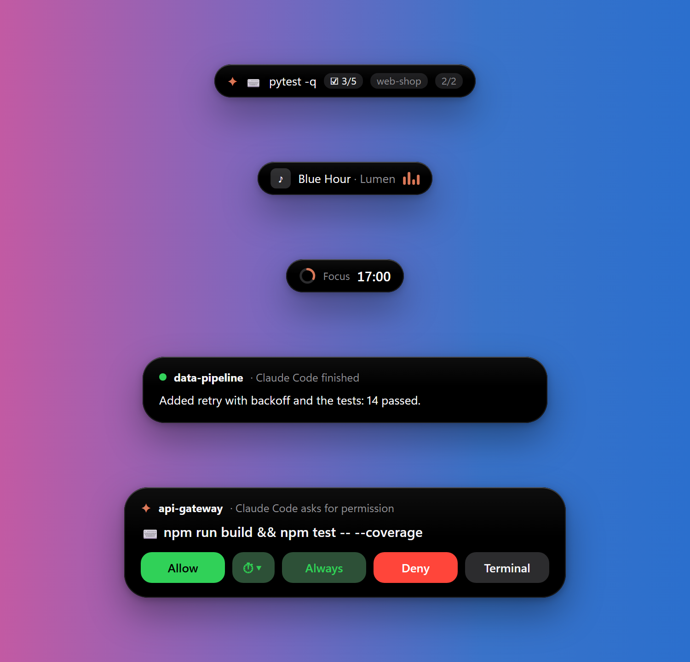
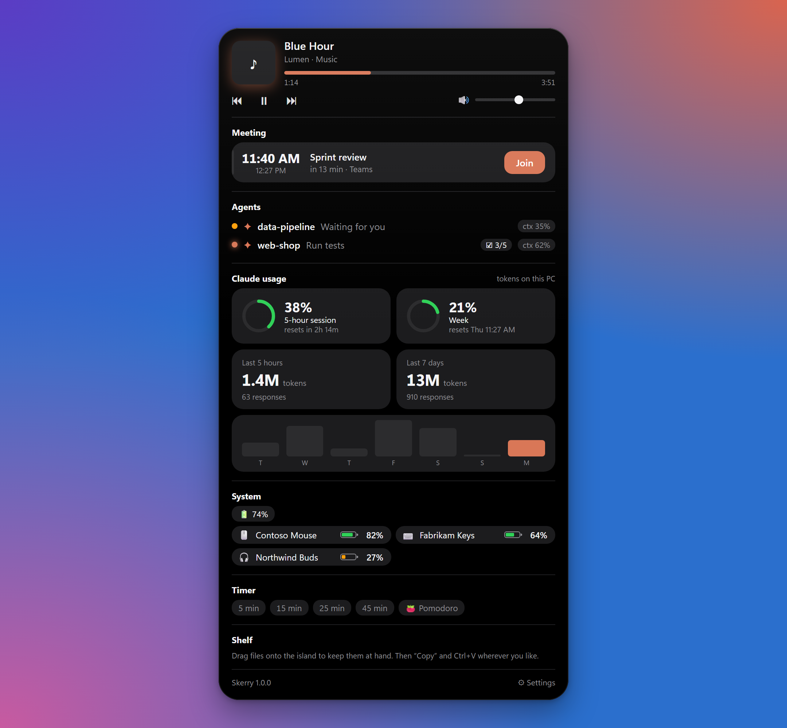
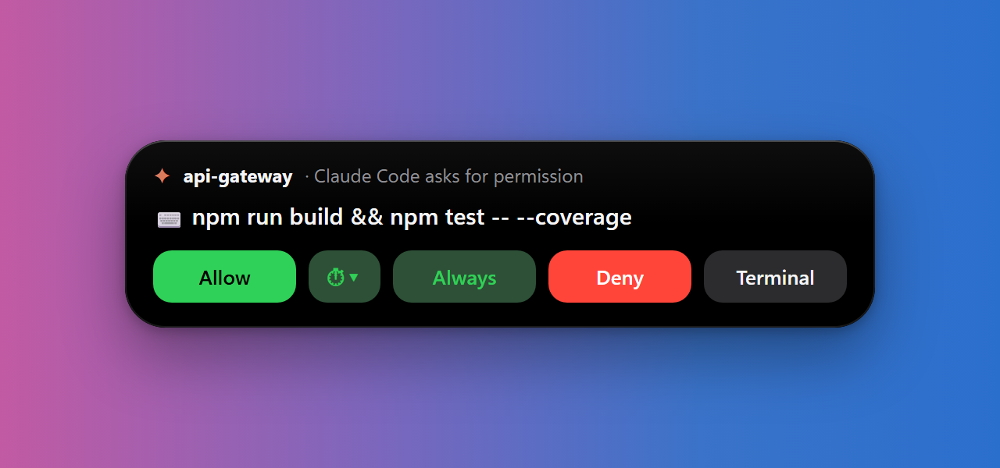
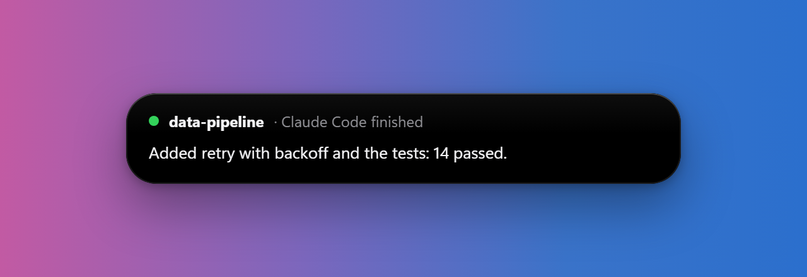
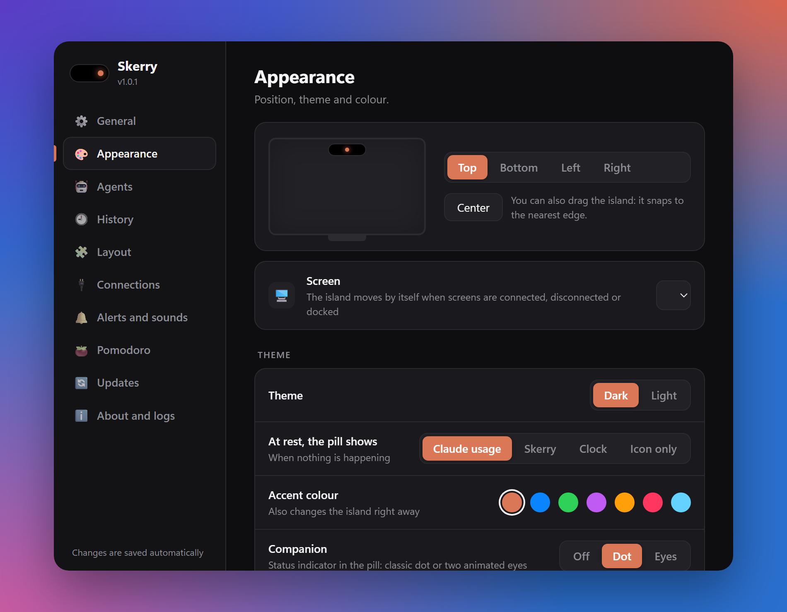
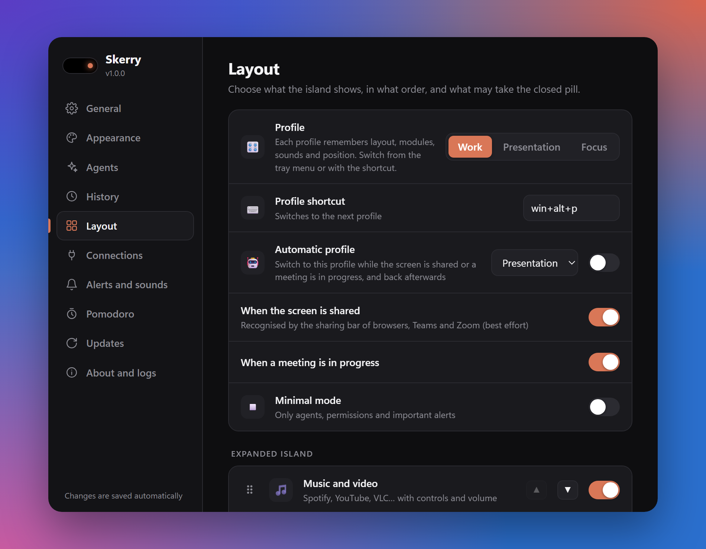
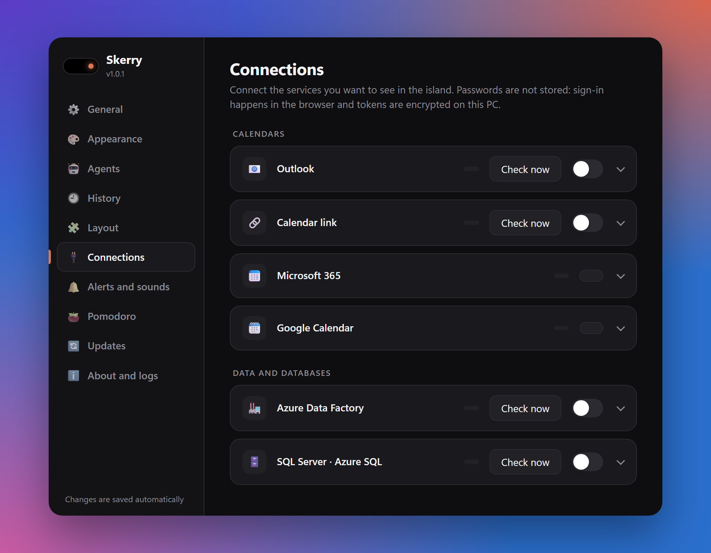

<p align="center">
  <picture>
    <source media="(prefers-color-scheme: dark)" srcset="assets/brand/skerry-logo-dark.svg">
    
  </picture>
</p>

<p align="center">
  <b>A dynamic island for Windows that shows what Claude Code and Codex are doing, and lets you approve their permission requests without leaving your work.</b>
</p>

<p align="center">
  <a href="https://github.com/fabrisimo/skerry/releases/latest"></a>
  &nbsp;
  <a href="https://paypal.me/fabrisimo00"></a>
</p>

<p align="center">
  <a href="https://github.com/fabrisimo/skerry/releases/latest"></a>
  <a href="https://github.com/fabrisimo/skerry/actions/workflows/ci.yml"></a>
  <a href="LICENSE"></a>
  
</p>

<p align="center"><b>English</b> · <a href="README.it.md">Italiano</a></p>

---

Skerry is a small always-on-top pill snapped to a screen edge. Besides your coding agents it shows Now Playing and
volume, microphone/camera in use, laptop and Bluetooth battery, a timer/Pomodoro, a file shelf, local token usage and
your next Microsoft 365 meeting. Everything runs locally.

<p align="center">
  
  &nbsp;
  
</p>

<details>
<summary>More screenshots</summary>

| | |
|---|---|
|  |  |
|  |  |
|  |  |
|  |  |

</details>

> The interface is available in English, Italian, Spanish, German and French: it follows the Windows display language, or pick one in
> *Settings → General → Language* (it switches immediately, no restart).

## Features

| Module | What it does |
|---|---|
| **Claude Code** | Current action, permission requests (*Allow · Allow for 5/15/60 min · Always · Deny · Terminal*), task progress, completion, per-session context, 5-hour/weekly limits with threshold alerts |
| **Codex** | Current action, permission requests, completion (through Codex hooks) |
| **OpenCode** (experimental) | Current action, permission requests, completion, errors |
| **GitHub Copilot CLI** | Current action, permission requests (*Allow · Allow for 5/15/60 min · Deny · Terminal*), completion, errors |
| **Gemini CLI** | Activity only: current action, completion, and *asks for permission: answer in the terminal* (Gemini CLI hooks cannot answer permission prompts) |
| **History** | Settings → History: agent sessions of the last 30 days by project, with duration, tokens (Claude Code) and the cost Claude Code reports; CSV export. Read from local files only |
| **Music and video** | Windows Now Playing (Spotify, YouTube in the browser, VLC…): cover art, accent colour from the cover, clickable progress bar, controls, volume with the wheel or a slider |
| **Microphone and camera** | Orange/green dot while an app is using them, with the app name |
| **Battery** | Laptops: plugged/unplugged and low battery |
| **Bluetooth devices** | Battery level of devices that report it, with a low-battery alert |
| **Timer and Pomodoro** | Countdown in the pill, configurable Pomodoro cycles |
| **File shelf** | Drop files on the pill, then *Copy* and Ctrl+V anywhere |
| **Claude usage** | Tokens used in the last 5 hours / 7 days, read from local Claude Code session files |
| **Meetings** | Next Microsoft 365 (Outlook/Teams) or Google Calendar (Meet) meeting with a *Join* button and an alert before it starts (optional) |
| **SQL Server · Azure SQL** | Widgets with a read-only query: the first value, green/amber/red by your thresholds, and an alert when one turns red (optional) |
| **Azure Data Factory** | Latest run of the pipelines you choose (succeeded, failed, running) in the expanded island, and an alert when one fails (optional) |

**Using it**

- **First launch**: the island walks you through three short steps (edge and screen, connect Claude Code
  and Codex, the shortcut). You can skip it and show it again from *Settings → General*.
- **Click** the pill to expand it; it collapses when the mouse leaves.
- **Drag** it: it snaps to the nearest edge (top, bottom, left, right), on any monitor. On the side edges it becomes a vertical tab.
- **Several screens**: *Settings → Appearance → Screen* keeps the island on the primary screen, on a specific one or on
  the screen with the mouse pointer. It moves by itself when screens are connected, disconnected or docked, and keeps
  the right size on screens with a different scale.
- **Mouse wheel**: on music it changes the volume, on agents it cycles through sessions.
- **`Win+Alt+I`** expands/collapses it from any app (configurable).
- **Click a session** in the expanded view to bring its terminal or VS Code window to the front.
- **Tray icon**: Settings, Pause, Start with Windows, updates, logs, Quit.
- It hides with **fullscreen** apps (permission requests stay visible, configurable) and, optionally, from **screen sharing and recording**.

## Installation

### Installer

1. Download `Skerry-Setup-x.y.z.exe` from [Releases](https://github.com/fabrisimo/skerry/releases).
2. Run it. No admin rights are needed; it installs to `%LOCALAPPDATA%\Programs\Skerry`.
   *Start with Windows* and *Connect Claude Code and Codex* are preselected.

Uninstalling disconnects the hooks from Claude Code and Codex and removes autostart.

> **Unsigned builds.** The executables and the installer are not code-signed yet, so Windows SmartScreen may show
> "Windows protected your PC / Unknown publisher" (*More info → Run anyway*) and some antivirus products may warn
> about or quarantine them. Each release lists the SHA-256 of the installer in `SHA256SUMS.txt`: you can compare it
> with `Get-FileHash .\Skerry-Setup-x.y.z.exe`.

### Updates

Skerry checks the GitHub releases at startup and every 6 hours (with an ETag, so unchanged answers cost nothing).
Pre-releases are ignored. *Settings → Updates* shows the status, the installed version, the last check and the
release notes, and lets you pick a mode:

- **Automatic** (default): the installer is downloaded, its **SHA-256 is verified** against the release's
  `SHA256SUMS.txt` (a mismatch deletes the file and nothing is installed), then the pill shows
  *Update to vX ready*. It installs at a quiet moment (no permission request waiting, nothing in fullscreen or
  presenting) or right away with *Update now*. The update is silent and Skerry restarts by itself.
- **Notify only**: the pill offers the update, you decide when.
- **Off**: no automatic checks (*Check now* still works).

If anything fails, the installed version keeps running and the reason goes to the log; no error windows.

### From source

Requirements: Windows 10/11, Python 3.11 or newer.

```powershell
git clone https://github.com/fabrisimo/skerry.git
cd skerry
.\setup_dev.bat      # creates a venv in %LOCALAPPDATA%\venvs\skerry and installs requirements.txt
.\run_dev.bat        # starts Skerry; log in .\logs\skerry.log
```

To build the installer yourself, install [Inno Setup 6](https://jrsoftware.org/isinfo.php) and run `.\build.bat`.
It creates `dist\Skerry\` (`Skerry.exe` and `skerry-cli.exe`), `dist\Skerry-Setup-x.y.z.exe` and
`dist\SHA256SUMS.txt`. Official releases are built by GitHub Actions when a version tag is pushed (see
[CONTRIBUTING.md](CONTRIBUTING.md#making-a-release)).

## Customising the island

**Settings → Layout** (it replaces the old *Modules* page; switches set there by older versions are kept):

- **Expanded island**: every section (music, meeting, Data Factory, SQL, agents, usage, system, timer, shelf) can be
  shown or hidden and reordered: drag the ⠿ handle, or use ▲ ▼ (also the arrow keys on the focused handle).
  *Restore default order* puts them back. Sections added by future versions appear at the end without changing your
  order.
- **Options** inside a section: which agents to show; microphone/camera, battery and **Bluetooth devices** (rename
  them or hide them right there, no more editing `bluetooth_names` by hand); **usage** as everything, tokens only,
  percentages only or today only; **meetings** from how many minutes before.
- **Closed pill priority**: when several things happen at once, the first one in this list takes the pill
  (agent at work, upcoming meeting, music, timer, low battery); each can be set to never take it. Permission
  requests always come first and cannot be hidden.
- **Minimal mode**: only agents, permission requests and important alerts (warnings and errors).
- **Profiles** *Work*, *Presentation* and *Focus*: each remembers layout, modules, sounds and position. Switch from the
  tray menu (**Profile**) or with the shortcut (`Win+Alt+P` by default, cycles through them). The first time,
  *Presentation* starts in minimal mode with quiet sounds and *Focus* keeps music out of the pill. Optional automatic
  rule: while the screen is shared or a meeting is in progress, switch to a chosen profile and back afterwards.
  Screen sharing is recognised by the "you are sharing" bars of browsers, Teams and Zoom (a best-effort list of
  window titles: Windows has no API for it).
- **Settings → General → Backup**: export all settings and profiles to a JSON file, or import one. Secrets are never
  in it (they are not in `settings.json`); on import Skerry ignores the update source, the chained status-line
  command and per-PC values, and drops SQL widgets whose query is not read-only.

### Companion (optional)

**Settings → Appearance → Companion** swaps the status dot for two small animated eyes (also offered in the guided
setup; never switched on by itself). They rest and blink, read while an agent works, grow and look down at the
buttons when a permission waits, smile when an agent finishes, look worried on errors or near a usage limit, glance
aside before a meeting and doze after 10 quiet minutes. With the pointer over the island they follow it.
*Energy* chooses lively or calm; with Windows animation effects off they keep their expressions but stop moving on
their own. Nothing animates while the island is hidden.


## Setting up Claude Code and Codex

Skerry receives events through the agents' **hooks**. It adds its own entries and leaves everything else untouched;
`~/.claude/settings.json` and `~/.codex/hooks.json` are backed up to `%LOCALAPPDATA%\Skerry\backup\` before every change.

Connect them in one of these ways:

- the installer option *Connect Claude Code and Codex* (on by default);
- **Settings → Agents → Connect**;
- from a terminal: `skerry-cli connect` (and `skerry-cli disconnect` to remove them).

Then:

- **Claude Code**: start a new session. Skerry registers `skerry-cli` command hooks (in the background, except the
  permission request, which waits for your answer) and a status line. When Skerry is not running they exit silently:
  no errors in Claude Code. An existing status line is kept and chained; disconnecting restores it.
- **Codex**: open Codex and approve the new hooks with `/hooks` (Codex only runs approved hooks).

**GitHub Copilot CLI, Gemini CLI and OpenCode** are never connected automatically: use **Settings → Agents → Connect**.

| | Where | Permissions |
|---|---|---|
| **Copilot CLI** | Skerry's own file `~/.copilot/hooks/skerry.json` (or `$COPILOT_HOME/hooks/`); disconnecting deletes it | Answered through the `permissionRequest` hook. If Skerry does not answer in time, Copilot asks in the terminal as usual |
| **OpenCode** (experimental) | Skerry's own plugin `~/.config/opencode/plugins/skerry.js` (or `$OPENCODE_CONFIG_DIR/plugins/`); disconnecting deletes it | Answered from the island through OpenCode's own server. If Skerry does not answer in time, or you answer in OpenCode first, OpenCode keeps its usual prompt |
| **Gemini CLI** | `skerry` entries in the `hooks` of `~/.gemini/settings.json` (backed up first; your other hooks stay) | **None.** Gemini CLI's permission notification is observability only, so Skerry shows that a prompt is waiting and you answer it in the terminal |

Both use `skerry-cli`, which always exits 0 when Skerry is not running (Copilot CLI would deny the tool if a
`preToolUse` hook failed) and always prints `{}` for Gemini CLI, which expects JSON. Gemini CLI waits for every
hook, so each event adds the start-up time of `skerry-cli` (short timeouts: 5 s). Gemini CLI was succeeded by
Antigravity CLI in June 2026; Skerry follows the Gemini CLI hooks documentation and was not tested with Antigravity.
Aider is not supported: it has no hooks and no way for another program to answer its confirmations.

**How permissions work.** When an agent asks for permission, the request waits in Skerry. *Consenti* (allow),
*Sempre* (always: applies the rule Claude Code suggests) and *Nega* (deny) answer it; *Terminale*, or no answer within
the configured time (5 minutes by default), hands the decision back to the agent's own prompt. If you answer in the
terminal instead, Skerry drops the request. If Skerry is not running, the hooks exit silently and the agents are never
blocked.

**Allow for N minutes.** The **⏱▾** button next to *Allow* offers *5 / 15 / 60 min*: it allows the request and, until
the time runs out, Skerry approves on its own the requests of the same agent for the same tool (e.g. `Bash`, `Edit`) in
the same project folder. A green **⏱ Bash 14:32** chip on the island shows each active rule with its countdown; click
it to revoke the rule. Rules live only in memory: they end when Skerry quits. Some requests always ask, and cannot
start a rule:

- commands containing `rm`, `rmdir`, `rd`, `del`, `erase`, `Remove-Item`, `format`, `drop`, `truncate`, or a forced
  `git push` (`--force`, `-f`, `+branch`);
- anything that may reach outside the project folder: absolute paths elsewhere, `..`, `~`, environment variables
  (`%VAR%`, `$env:`), POSIX absolute paths, file tools on files outside the folder, patches that delete files;
- requests that do not say which folder they run in.

The check reads the command text, so it errs on the side of asking (`git log --format=…` contains *format*). It
cannot see what a script or program does once it runs (`python clean.py` is approved like any other `python` call):
use short rules for tools that run arbitrary code.

> **Note** — the 5-hour/weekly limits are reported by Claude Code only on Pro/Max plans. On other plans Skerry still
> shows context, sessions and local token usage.

If you run from source, *Connect* points the hooks at `python cli.py`. After installing with the installer, reconnect so
they use `skerry-cli.exe`.

## Connections (optional)

Skerry can also show data from a few services. Every connector is **read-only** and optional; secrets and tokens are
encrypted with Windows DPAPI, never written to `settings.json`. The same step-by-step guides are in
**Settings → Connections**.

| Connector | What you get | Setup |
|---|---|---|
| **Outlook on this PC** | Next meeting from classic Outlook, with its Teams/Meet/Zoom link. No sign-in, no setup | [Guide](docs/connectors.md#outlook-on-this-pc) |
| **Calendar link (ICS)** | Next meeting from the private link of an Outlook on the web or Google calendar. No sign-in | [Guide](docs/connectors.md#calendar-link-ics) |
| **Microsoft 365** | Next Outlook/Teams meeting with a *Join* button and an alert before it starts | [Guide](docs/connectors.md#microsoft-365) |
| **Google Calendar** | Next event with its Google Meet link | [Guide](docs/connectors.md#google-calendar) |
| **Azure Data Factory** | Latest run of the pipelines you choose, alert when one fails | [Guide](docs/connectors.md#azure-data-factory) |
| **SQL Server · Azure SQL** | Query widgets with green/amber/red thresholds | [Guide](docs/connectors.md#sql-server-and-azure-sql-widgets) |

## Privacy

**No telemetry; your data stays on your PC.**

- Skerry sends no analytics, crash reports or usage data anywhere.
- The hook server listens only on `127.0.0.1`. Permission decisions come only from the Skerry window, never over HTTP.
- Token usage is computed from the Claude Code session files on disk; nothing is uploaded.
- **History** (Settings → History) reads only local files: Claude Code's session files and
  `%LOCALAPPDATA%\Skerry\history.jsonl`, where Skerry writes a line per agent session event (agent, session id,
  project folder name, time, cost reported by Claude Code). Lines older than 30 days are deleted. *Export CSV* writes
  only where you choose. Codex, Copilot CLI and Gemini CLI tokens are not shown: their local logs have no documented
  format.
- Network access happens only for: the update check (GitHub releases API every 6 hours, plus the installer download
  when an update exists; can be turned off in settings) and, if you connect them, Microsoft Graph and the Google
  Calendar API to read your calendar and Azure Resource Manager to read Data Factory pipeline runs; SQL widgets connect only to the servers you enter.
- Secrets (the Microsoft 365 token cache, the Google client secret and refresh token, the Data Factory client
  secret, SQL passwords) are encrypted with DPAPI and readable only by your Windows user.

| Path | Content |
|---|---|
| `%APPDATA%\Skerry\settings.json` | Settings (no secrets) |
| `%APPDATA%\Skerry\shelf.json` | Files on the shelf (paths only) |
| `%APPDATA%\Skerry\secrets\` | Connector tokens (DPAPI-encrypted) |
| `%LOCALAPPDATA%\Skerry\logs\` | Rotating logs |
| `%LOCALAPPDATA%\Skerry\backup\` | Backups of the agents' configuration |
| `%LOCALAPPDATA%\Skerry\history.jsonl` | Agent session history (30 days) |

## How it works

```
Claude Code ──skerry-cli hook claude─────▶ 127.0.0.1:47800 ─┐
Claude Code ──skerry-cli statusline──────▶ /statusline      ─┼─▶ Store ─▶ UI (pywebview / WebView2)
Codex ───────skerry-cli hook codex───────▶ /hook/...        ─┘
Windows (media, audio, registry, power, Bluetooth), M365, local usage ─▶ modules ─▶ UI
```

Python 3.11+, pywebview on WebView2, a local Flask server, and a plain HTML/JS/CSS UI. `Skerry.exe` runs the app under a
supervisor that restarts it on crash. See [`CLAUDE.md`](CLAUDE.md) for the module map and design notes.

## Contributing

Contributions are welcome! Read [CONTRIBUTING.md](CONTRIBUTING.md) for the development setup, checks and guidelines, and
the [Code of Conduct](CODE_OF_CONDUCT.md). Report security issues privately as described in [SECURITY.md](SECURITY.md).

## Support

Skerry is free and open source. If it saves you some clicks, you can
[buy me a coffee](https://paypal.me/fabrisimo00) ☕ — thank you!

<a href="https://paypal.me/fabrisimo00"></a>

## License

[MIT](LICENSE) © Fabrizio (fabrisimo)

Skerry is an independent project, not affiliated with or endorsed by Anthropic, OpenAI or Microsoft.
