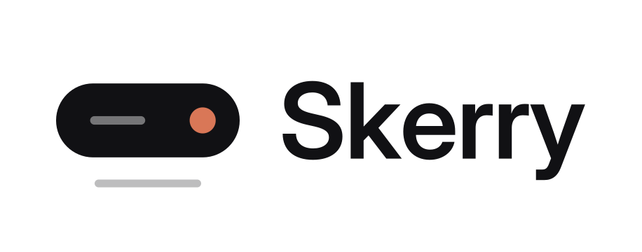
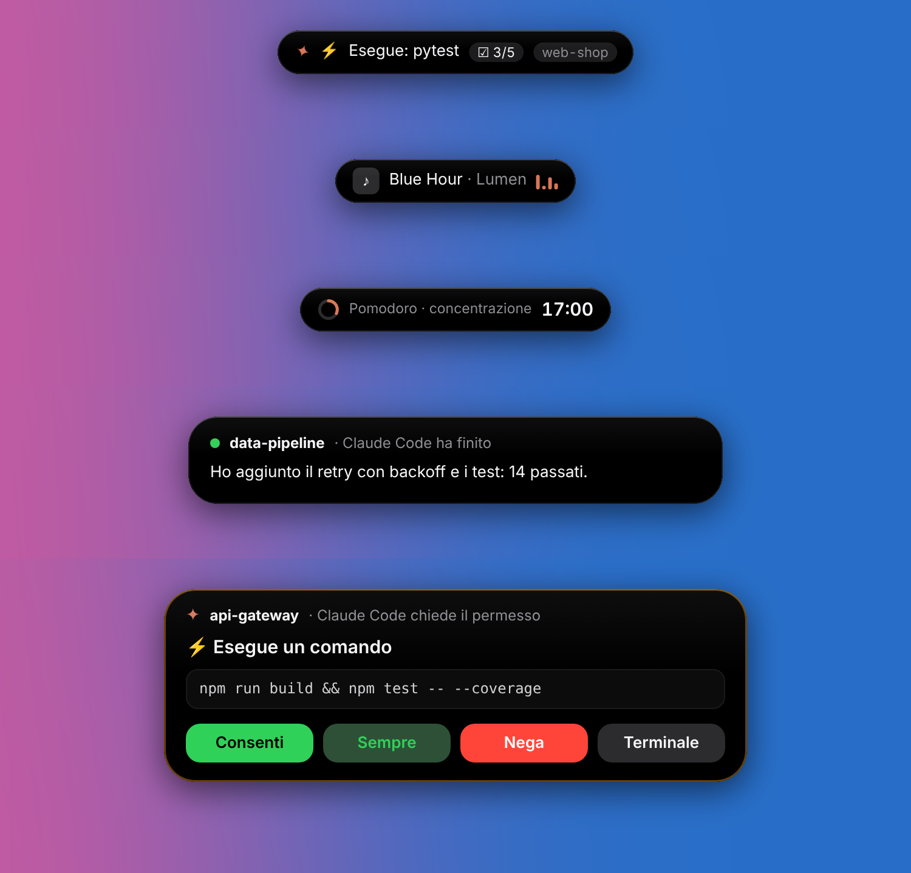
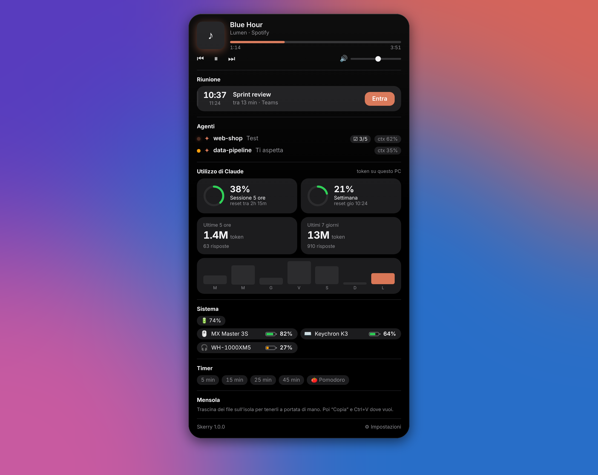
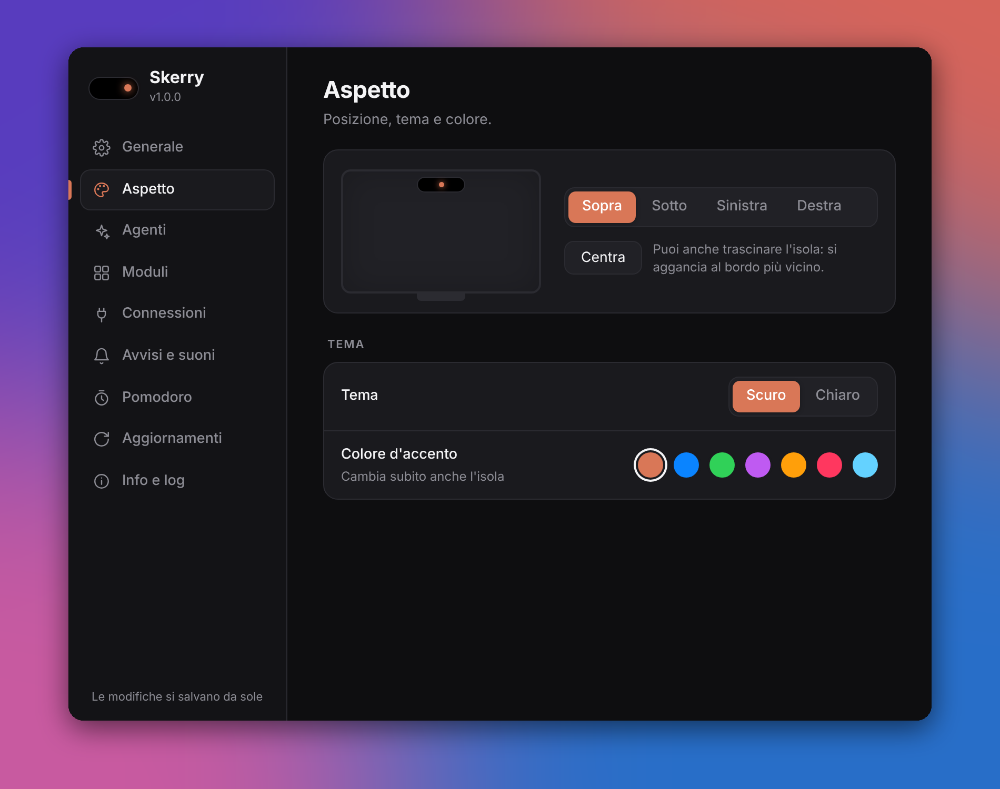
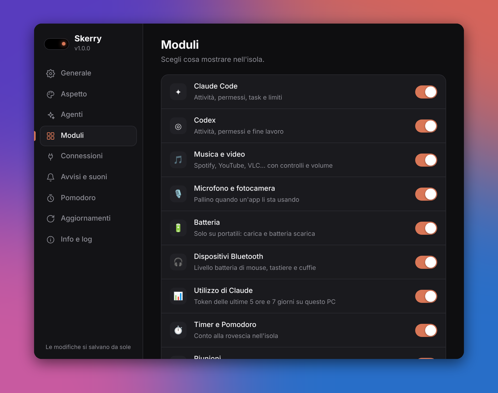
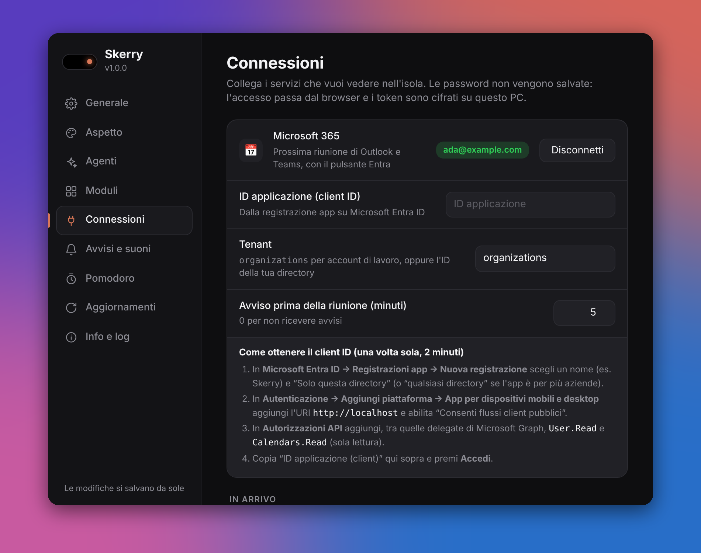

<p align="center">
  <picture>
    <source media="(prefers-color-scheme: dark)" srcset="assets/brand/skerry-logo-dark.svg">
    
  </picture>
</p>

<p align="center">
  <b>A dynamic island for Windows that shows what Claude Code and Codex are doing, and lets you approve their permission requests without leaving your work.</b>
</p>

<p align="center">
  <a href="https://github.com/fabrisimo/skerry/actions/workflows/ci.yml"></a>
  <a href="LICENSE"></a>
  
</p>

<p align="center"><b>English</b> · <a href="README.it.md">Italiano</a></p>

---

Skerry is a small always-on-top pill snapped to a screen edge. Besides your coding agents it shows Now Playing and
volume, microphone/camera in use, laptop and Bluetooth battery, a timer/Pomodoro, a file shelf, local token usage and
your next Microsoft 365 meeting. Everything runs locally.

<p align="center">
  
  &nbsp;
  
</p>

<details>
<summary>More screenshots</summary>

| | |
|---|---|
|  |  |
|  |  |
|  |  |
|  |  |

</details>

> The user interface is currently in Italian.

## Features

| Module | What it does |
|---|---|
| **Claude Code** | Current action, permission requests (*Allow · Always · Deny · Terminal*), task progress, completion, per-session context, 5-hour/weekly limits with threshold alerts |
| **Codex** | Current action, permission requests, completion (through Codex hooks) |
| **Music and video** | Windows Now Playing (Spotify, YouTube in the browser, VLC…): cover art, accent colour from the cover, clickable progress bar, controls, volume with the wheel or a slider |
| **Microphone and camera** | Orange/green dot while an app is using them, with the app name |
| **Battery** | Laptops: plugged/unplugged and low battery |
| **Bluetooth devices** | Battery level of devices that report it, with a low-battery alert |
| **Timer and Pomodoro** | Countdown in the pill, configurable Pomodoro cycles |
| **File shelf** | Drop files on the pill, then *Copy* and Ctrl+V anywhere |
| **Claude usage** | Tokens used in the last 5 hours / 7 days, read from local Claude Code session files |
| **Meetings** | Next Microsoft 365 (Outlook/Teams) meeting with a *Join* button and an alert before it starts (optional) |

**Using it**

- **Click** the pill to expand it; it collapses when the mouse leaves.
- **Drag** it: it snaps to the nearest edge (top, bottom, left, right), on any monitor. On the side edges it becomes a vertical tab.
- **Mouse wheel**: on music it changes the volume, on agents it cycles through sessions.
- **`Win+Alt+I`** expands/collapses it from any app (configurable).
- **Click a session** in the expanded view to bring its terminal or VS Code window to the front.
- **Tray icon**: Settings, Pause, Start with Windows, updates, logs, Quit.
- It hides with **fullscreen** apps (permission requests stay visible, configurable) and, optionally, from **screen sharing and recording**.

## Installation

### Installer

1. Download `Skerry-Setup-x.y.z.exe` from [Releases](https://github.com/fabrisimo/skerry/releases).
2. Run it. No admin rights are needed; it installs to `%LOCALAPPDATA%\Programs\Skerry`.
   *Start with Windows* and *Connect Claude Code and Codex* are preselected.

The executables are not code-signed yet, so SmartScreen may show "Unknown publisher" (*More info → Run anyway*).
Uninstalling disconnects the hooks from Claude Code and Codex and removes autostart.

### From source

Requirements: Windows 10/11, Python 3.11 or newer.

```powershell
git clone https://github.com/fabrisimo/skerry.git
cd skerry
.\setup_dev.bat      # creates a venv in %LOCALAPPDATA%\venvs\skerry and installs requirements.txt
.\run_dev.bat        # starts Skerry; log in .\logs\skerry.log
```

To build the installer yourself, install [Inno Setup 6](https://jrsoftware.org/isinfo.php) and run `.\build.bat`.
It creates `dist\Skerry\` (`Skerry.exe` and `skerry-cli.exe`) and `dist\Skerry-Setup-x.y.z.exe`.

## Setting up Claude Code and Codex

Skerry receives events through the agents' **hooks**. It adds its own entries and leaves everything else untouched;
`~/.claude/settings.json` and `~/.codex/hooks.json` are backed up to `%LOCALAPPDATA%\Skerry\backup\` before every change.

Connect them in one of these ways:

- the installer option *Connect Claude Code and Codex* (on by default);
- **Settings → Agenti → Collega**;
- from a terminal: `skerry-cli connect` (and `skerry-cli disconnect` to remove them).

Then:

- **Claude Code**: start a new session. Skerry registers HTTP hooks, a `SessionStart` command hook (to find the terminal
  window) and a status line. An existing status line is kept and chained; disconnecting restores it.
- **Codex**: open Codex and approve the new hooks with `/hooks` (Codex only runs approved hooks).

**How permissions work.** When an agent asks for permission, the request waits in Skerry. *Consenti* (allow),
*Sempre* (always: applies the rule Claude Code suggests) and *Nega* (deny) answer it; *Terminale*, or no answer within
the configured time (5 minutes by default), hands the decision back to the agent's own prompt. If you answer in the
terminal instead, Skerry drops the request. If Skerry is not running, the hooks exit silently and the agents are never
blocked.

> **Note** — the 5-hour/weekly limits are reported by Claude Code only on Pro/Max plans. On other plans Skerry still
> shows context, sessions and local token usage.

If you run from source, *Collega* points the hooks at `python cli.py`. After installing with the installer, reconnect so
they use `skerry-cli.exe`.

## Connecting Microsoft 365 (optional)

Skerry can show your next Outlook/Teams meeting with a *Join* button. It uses Microsoft Graph, **read-only**, with a
browser sign-in: no password is stored, and the token cache is encrypted with Windows DPAPI.

You need an app registration in Microsoft Entra ID (once, a couple of minutes). If you can't create one, ask your
IT administrator.

1. Open the [Microsoft Entra admin center](https://entra.microsoft.com) → **Identity → Applications → App registrations → New registration**.
   - Name: anything, e.g. `Skerry`.
   - Supported account types: *Accounts in this organizational directory only* (or *any organizational directory* if
     several organizations will use it).
   - Leave the redirect URI empty and click **Register**.
2. **Authentication → Add a platform → Mobile and desktop applications**, add the redirect URI `http://localhost`.
   Under **Advanced settings**, set **Allow public client flows** to *Yes*. Save.
3. **API permissions → Add a permission → Microsoft Graph → Delegated permissions**: add `User.Read` and
   `Calendars.Read`. Depending on your organization's policy, an administrator may need to *Grant admin consent*.
4. On the **Overview** page copy the **Application (client) ID**.
5. In Skerry: **Settings → Connessioni → Microsoft 365**, paste the client ID. *Tenant*: keep `organizations`, or put
   your directory (tenant) ID. Click **Accedi** (sign in) and complete the sign-in in the browser.

No client secret is needed: Skerry is a public client. *Disconnetti* (sign out) deletes the local token cache.

## Privacy

**No telemetry; your data stays on your PC.**

- Skerry sends no analytics, crash reports or usage data anywhere.
- The hook server listens only on `127.0.0.1`. Permission decisions come only from the Skerry window, never over HTTP.
- Token usage is computed from the Claude Code session files on disk; nothing is uploaded.
- Network access happens only for: the update check (GitHub releases API, can be turned off in settings) and, if you
  connect it, Microsoft Graph to read your calendar.
- Secrets (the Microsoft 365 token cache) are encrypted with DPAPI and readable only by your Windows user.

| Path | Content |
|---|---|
| `%APPDATA%\Skerry\settings.json` | Settings (no secrets) |
| `%APPDATA%\Skerry\shelf.json` | Files on the shelf (paths only) |
| `%APPDATA%\Skerry\secrets\` | Connector tokens (DPAPI-encrypted) |
| `%LOCALAPPDATA%\Skerry\logs\` | Rotating logs |
| `%LOCALAPPDATA%\Skerry\backup\` | Backups of the agents' configuration |

## How it works

```
Claude Code ──http hooks─────────────────▶ 127.0.0.1:47800 ─┐
Claude Code ──skerry-cli statusline──────▶ /statusline      ─┼─▶ Store ─▶ UI (pywebview / WebView2)
Codex ───────skerry-cli hook codex───────▶ /hook/...        ─┘
Windows (media, audio, registry, power, Bluetooth), M365, local usage ─▶ modules ─▶ UI
```

Python 3.11+, pywebview on WebView2, a local Flask server, and a plain HTML/JS/CSS UI. `Skerry.exe` runs the app under a
supervisor that restarts it on crash. See [`CLAUDE.md`](CLAUDE.md) for the module map and design notes.

## Contributing

Contributions are welcome! Read [CONTRIBUTING.md](CONTRIBUTING.md) for the development setup, checks and guidelines, and
the [Code of Conduct](CODE_OF_CONDUCT.md). Report security issues privately as described in [SECURITY.md](SECURITY.md).

## License

[MIT](LICENSE) © Fabrizio (fabrisimo)

Skerry is an independent project, not affiliated with or endorsed by Anthropic, OpenAI or Microsoft.
